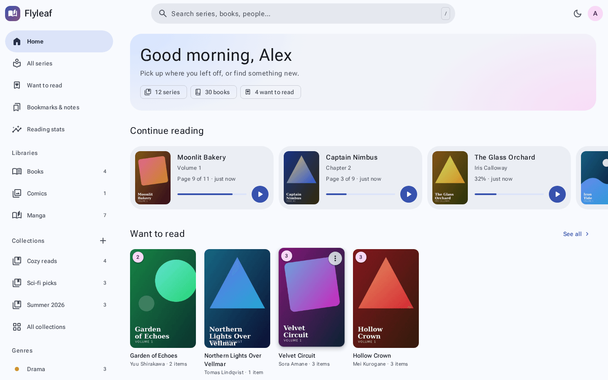

# 🌿 Flyleaf — Your library. Your happy little place.

A warm, expressive showcase for **[Flyleaf](https://github.com/niruxx/Flyleaf)**, the self-hosted library and reader for books, manga and comics.



## ✨ What’s inside

- Material Design 3 Expressive inspired styling: soft green surfaces, playful shapes, generous typography and rounded controls.
- Real, locally hosted desktop and mobile screenshots from Flyleaf.
- Interactive reader illustration with three sample pages, paper/sepia/dark themes, font sizing and session bookmarks.
- Product overview and reasons to choose a self-hosted library.
- Responsive layouts, keyboard controls, visible focus, skip link and reduced-motion support.
- Static HTML, CSS and JavaScript. No dependencies or build step.

## 🚀 Run locally

Open `index.html` directly, or serve the repository:

```sh
python -m http.server 8000
```

Visit **http://localhost:8000**. Google Fonts is optional; system fonts provide an offline fallback.

## 🌐 Publish on GitHub Pages

1. Push this repository to GitHub on `main`.
2. Open **Settings → Pages → Build and deployment**.
3. Choose **GitHub Actions** as the source.
4. Run **Deploy to GitHub Pages** from Actions, or push a commit to `main`.

The workflow uploads only public website files. The live URL appears in the deployment and Pages settings. Relative assets support project sites and custom domains.

Alternatively, choose **Deploy from a branch → main → / (root)**. This checkout is prepared for deployment; it has not been published.

## 🛠️ Make it yours

| File | Purpose |
| --- | --- |
| `index.html` | Content and screenshot layout |
| `styles.css` | Colour tokens, typography and responsive styling |
| `script.js` | Reader illustration and controls |
| `assets/` | Screenshots, icon and upstream license |
| `.github/workflows/pages.yml` | GitHub Pages deployment |

Edit the tokens in `styles.css` to change the palette. Refresh images in `assets/` and check product copy against the upstream README as Flyleaf evolves.

## 📖 About the demo

The embedded reader is an illustration, **not the Flyleaf application**. It does not upload books, connect to a server or persist data. Install the full app using the [official instructions](https://github.com/niruxx/Flyleaf#readme). GitHub Pages hosts this showcase; Flyleaf itself needs its own server.

## 💚 Credits

Product details, screenshots and icon: [niruxx/Flyleaf](https://github.com/niruxx/Flyleaf), described as MIT licensed in its README. Asset sources and licensing notes are in [`assets/ATTRIBUTION.md`](assets/ATTRIBUTION.md). Cover artwork visible in upstream screenshots retains its respective rights. Reader excerpt: Lewis Carroll’s *Alice’s Adventures in Wonderland* (public domain). DM Sans and Manrope are served through Google Fonts.

